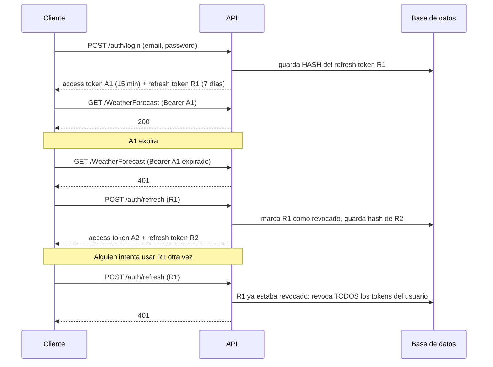

# Refresh tokens: guía de estudio

Continuación de [AUTENTICACION-JWT.md](AUTENTICACION-JWT.md). Aquí se agrega **renovación de sesión** (refresh token), **rotación**, **revocación** y **detección de robo** sobre el mismo proyecto.

## 1. El problema que resuelve

Un JWT (access token) no se puede cancelar: mientras no expire, es válido. Eso lleva a un dilema:

| Si el access token dura... | Consecuencia |
| --- | --- |
| Mucho (horas o días) | Si lo roban, el atacante tiene acceso todo ese tiempo y no puedes revocarlo |
| Poco (minutos) | Más seguro, pero el usuario tendría que escribir su contraseña cada pocos minutos |

**Solución: dos tokens.**

| | Access token | Refresh token |
| --- | --- | --- |
| Qué es | JWT firmado | Cadena aleatoria opaca (no es JWT) |
| Dura | Poco (aquí 15 min) | Mucho (aquí 7 días) |
| Se guarda en el servidor | No (stateless) | **Sí**, en la tabla `RefreshTokens` |
| Para qué sirve | Llamar a la API (`Authorization: Bearer ...`) | Solo para pedir un access token nuevo en `/auth/refresh` |
| Se puede revocar | No hasta que expire | **Sí**, en cualquier momento |

El refresh token puede durar más porque está guardado en el servidor: si se sospecha de él, se marca como revocado y deja de servir.

## 2. El flujo completo



## 3. Conceptos clave

- **Rotación:** cada vez que se usa un refresh token, se revoca y se entrega uno nuevo. Un refresh token sirve **una sola vez**.
- **Detección de reutilización:** si llega un refresh token que ya estaba revocado, solo hay dos explicaciones: un bug del cliente o un robo. Se asume robo y se revocan todos los tokens activos del usuario; hay que volver a iniciar sesión. Pasa en el paso 4 y 5 de las pruebas.
- **Guardar el hash, no el token:** en la base solo está el SHA-256 del refresh token. Si la base se filtra, esos hashes no sirven para llamar a `/auth/refresh`. Es la misma idea que no guardar contraseñas en texto plano. Como el token ya es aleatorio de 64 bytes, basta SHA-256 (no hace falta salt ni un hash lento como en contraseñas).
- **Logout:** `/auth/revoke` revoca el refresh token. El access token ya emitido sigue válido hasta que expire; por eso debe ser corto.
- **Qué NO hace el refresh token:** no vuelve más seguro un access token robado durante sus 15 minutos de vida. Solo limita cuánto puede encadenar un atacante renovaciones.

## 4. Paso a paso de la implementación

### Paso 1: configuración

`appsettings.json`: access token corto, refresh token largo.

```json
"JwtSettings": {
  "Key": "...",
  "Issuer": "...",
  "Audience": "...",
  "ExpiryMinutes": 15,
  "RefreshTokenDays": 7
}
```

`Auth/JwtSettings.cs` necesita la propiedad nueva `public int RefreshTokenDays { get; set; }`. Si falta, el valor se queda en 0 y los refresh tokens nacen ya expirados.

### Paso 2: la entidad `RefreshToken`

`Entities/RefreshToken.cs` es una fila por cada refresh token emitido.

```csharp
public class RefreshToken
{
    public int Id { get; set; }
    public string TokenHash { get; set; } = string.Empty;   // hash, nunca el token
    public string UserId { get; set; } = string.Empty;
    public DateTime Created { get; set; }
    public DateTime Expires { get; set; }
    public DateTime? Revoked { get; set; }                  // null = no revocado
    public string? ReplacedByTokenHash { get; set; }        // quién lo reemplazó al rotar
    public bool IsActive => Revoked is null && DateTime.UtcNow < Expires;
}
```

`IsActive` es una propiedad calculada: EF Core la ignora (no tiene setter) y no se guarda.

### Paso 3: la tabla en el DbContext

```csharp
public DbSet<RefreshToken> RefreshTokens => Set<RefreshToken>();

protected override void OnModelCreating(ModelBuilder builder)
{
    base.OnModelCreating(builder);   // imprescindible: configura las tablas de Identity
    builder.Entity<RefreshToken>(entity =>
    {
        entity.HasIndex(t => t.TokenHash).IsUnique();   // se busca por hash en cada refresh
        entity.HasOne<ApplicationUser>().WithMany()
              .HasForeignKey(t => t.UserId)
              .OnDelete(DeleteBehavior.Cascade);
    });
}
```

### Paso 4: `ITokenService` y `TokenService`

Tres responsabilidades, todas sin acceso a la base de datos (`claims` son los claims del usuario y `permissions` solo se graban en el token en modo `Token`; ver [PERMISSION-BASED-AUTHORIZATION.md](PERMISSION-BASED-AUTHORIZATION.md)):

```csharp
(string Token, DateTime ExpiresAt) CreateAccessToken(
    ApplicationUser user, IEnumerable<string> roles,
    IEnumerable<Claim> claims, IEnumerable<string> permissions);
string CreateRefreshToken();         // 64 bytes aleatorios en Base64
string HashToken(string token);      // SHA-256 en hexadecimal
```

```csharp
public string CreateRefreshToken() =>
    Convert.ToBase64String(RandomNumberGenerator.GetBytes(64));

public string HashToken(string token) =>
    Convert.ToHexString(SHA256.HashData(Encoding.UTF8.GetBytes(token)));
```

Usa siempre `RandomNumberGenerator` (criptográficamente seguro), nunca `Random`.

### Paso 5: DTOs

```csharp
public record RefreshRequest([Required] string RefreshToken);
public record RevokeRequest([Required] string RefreshToken);

public record AuthResponse(
    string UserId, string Email, IEnumerable<string> Roles, IEnumerable<string> Permissions,
    string AccessToken, DateTime AccessTokenExpiresAt,
    string RefreshToken, DateTime RefreshTokenExpiresAt);
```

### Paso 6: el controller

El controller recibe además `PermissionStore`, `AppDbContext db` e `IOptions<JwtSettings> jwtSettings`. Tres ideas:

1. **Una sola función emite los tokens** (`IssueTokensAsync`). `register`, `login` y `refresh` la usan, así no hay código duplicado.
2. **La rotación es atómica.** Al refrescar, el token viejo se marca como revocado y el nuevo se inserta antes de un único `SaveChangesAsync()`. O pasan las dos cosas o ninguna.
3. **Todas las respuestas de error de `/refresh` son iguales (401 con el mismo mensaje).** No se le dice al cliente si el token no existe, expiró o fue revocado.

```csharp
[HttpPost("refresh")]
[AllowAnonymous]
public async Task<ActionResult<AuthResponse>> Refresh(RefreshRequest request)
{
    var hash = tokenService.HashToken(request.RefreshToken);
    var existing = await db.RefreshTokens.FirstOrDefaultAsync(t => t.TokenHash == hash);

    if (existing is null) return Unauthorized(...);              // nunca lo emitimos

    if (!existing.IsActive)
    {
        if (existing.Revoked is not null)                        // reutilización = posible robo
            await RevokeAllActiveTokensAsync(existing.UserId);
        return Unauthorized(...);                                // (expirado: solo se rechaza)
    }

    var user = await userManager.FindByIdAsync(existing.UserId);
    if (user is null) return Unauthorized(...);

    return Ok(await IssueTokensAsync(user, replacing: existing)); // rotación
}
```

Además se leen los roles, los claims y los permisos **de nuevo** en cada refresh: si un admin cambió los roles del usuario o los permisos de un rol, el access token nuevo ya lo refleja.

### Paso 7: base de datos

La app usa `EnsureCreatedAsync`, que **solo crea tablas si la base no existe**. Si ya tenías un `auth.db` de antes, no añade la tabla `RefreshTokens` y verás un error `no such table: RefreshTokens`.

- Solución en desarrollo: **detén la app, borra `auth.db` y vuelve a arrancar** (se recrea con el admin sembrado).
- Solución duradera: usar migraciones (`dotnet ef migrations add ...` y `Database.Migrate()`), que sí evolucionan el esquema.

## 5. Cómo probarlo

| # | Acción | Resultado esperado |
| --- | --- | --- |
| 1 | `POST /auth/login` | 200 con `accessToken` y `refreshToken` |
| 2 | `GET /WeatherForecast` con el access token del admin | 200 |
| 3 | `POST /auth/refresh` con el refresh token | 200 con un access y un refresh **distintos** |
| 4 | `POST /auth/refresh` con el refresh token **viejo** | 401 (reutilización detectada) |
| 5 | `POST /auth/refresh` con el refresh token **nuevo** del paso 3 | 401 (se revocó toda la familia) |
| 6 | `POST /auth/refresh` con un valor inventado | 401 |
| 7 | `POST /auth/revoke` con un refresh token activo, y luego `/auth/refresh` con ese mismo | 200 y después 401 |
| 8 | `POST /auth/add-role` con token de un usuario normal | 403 |

```bash
curl -X POST http://localhost:5224/auth/login -H "Content-Type: application/json" \
  -d '{"email":"admin@example.com","password":"Admin123!"}'

curl -X POST http://localhost:5224/auth/refresh -H "Content-Type: application/json" \
  -d '{"refreshToken":"<REFRESH_TOKEN>"}'
```

## 6. Dónde guarda el cliente cada token

Esto no está en la API, pero es la mitad de la seguridad:

| Cliente | Recomendación |
| --- | --- |
| Aplicación web (SPA) | Idealmente el refresh token en una cookie `HttpOnly; Secure; SameSite`, para que JavaScript no pueda leerlo; el access token solo en memoria |
| Móvil | Almacén seguro del sistema (Keychain / Keystore) |
| Evitar | `localStorage` para el refresh token: cualquier script inyectado (XSS) puede leerlo |

## 7. Mejoras para seguir practicando

- Limpiar periódicamente los refresh tokens expirados o revocados de la tabla (un `BackgroundService`).
- Limitar el número de sesiones activas por usuario.
- Guardar IP y *user agent* en cada refresh token para mostrar "sesiones activas" y revocar una concreta.
- Endpoint `POST /auth/revoke-all` protegido con `[Authorize]` para "cerrar sesión en todos los dispositivos".
- Cambiar HS256 por RS256 y publicar las claves en un endpoint JWKS.
- Pasar de `EnsureCreatedAsync` a migraciones.
